# 雅思模考

**一个原生 macOS 雅思模拟考试客户端。** 内置剑桥雅思 4–18 全部 60 套学术类真题（听力 / 阅读 / 写作 / 口语），界面参照雅思官方机考，带真实倒计时和时间提醒；口语由考官语音提问、本地语音识别转写，按官方评分标准打分。交卷后可以接入你自己的 Claude 或 OpenAI API Key，让 AI 逐题解析错题、给作文和口语打分并提出修改建议。

[⬇️ 下载最新版 DMG](../../releases/latest) · macOS 14 及以上 · Apple Silicon（M 系列芯片）

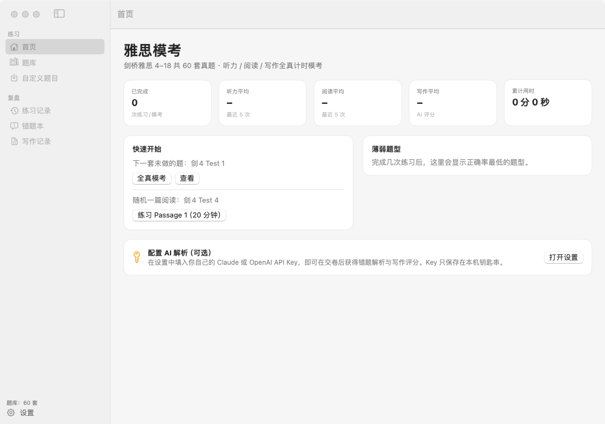

---

## 目录

- [功能一览](#功能一览)
- [界面预览](#界面预览)
- [安装](#安装)
- [使用指南](#使用指南)
- [口语模考与评分](#口语模考与评分)
- [AI 解析与写作评分（BYOK）](#ai-解析与写作评分byok)
- [题库说明](#题库说明)
- [从源码构建](#从源码构建)
- [题库是怎么做出来的](#题库是怎么做出来的)
- [仓库结构](#仓库结构)
- [隐私](#隐私)
- [第三方组件](#第三方组件)
- [版权声明](#版权声明)

---

## 功能一览

### 真题题库
- **剑桥雅思 4–18，共 60 套学术类真题**（剑 12 为 Test 5–8），每套包含完整的听力、阅读、写作、口语四个科目。
- 听力配**官方录音**和**完整听力原文**（带原书页边的题号定位标记）。
- 写作附原书的**考官范文 / 考生范文**、分数和考官评语（共 120 篇）。
- 口语收录原书全部题目：**243 道 Part 1 问题、60 张 Part 2 题卡、360 道 Part 3 讨论题**。
- 覆盖全部常见题型：笔记 / 表格 / 流程图 / 摘要 / 句子填空，单选、多选，TRUE/FALSE/NOT GIVEN、YES/NO/NOT GIVEN，段落标题匹配、段落信息匹配、人物 / 特征分类匹配，地图 / 平面图 / 示意图标注等。
- 支持导入自定义题目（同一份 JSON 格式），也可以为缺失或想替换的听力单独导入音频。

### 模拟考试
- **三种模式**
  - **全真模考**：听力 → 阅读 → 写作连考，严格计时，中途不能暂停。
  - **单科模考**：只考听力、阅读或写作中的一科。
  - **专项练习**：单个 Part / Passage / Task 限时练习，可以暂停。
- **真实计时**
  - 阅读 60 分钟、写作 60 分钟（建议 Task 1 用 20 分钟、Task 2 用 40 分钟）。
  - 听力以录音为准：录音连续播放、不能回放，播完后有检查时间，可在设置中选机考 2 分钟或纸笔考 10 分钟。
- **时间提醒**：剩余 10 / 5 / 1 分钟时在界面顶部弹出提醒，App 在后台时也会发系统通知，可以开启提示音。
- **中途退出可恢复**：自动保存进度，下次从首页继续。

### 机考同款界面
- 顶栏显示 "35 minutes left"，最后两分钟按秒倒计时；可点 **Hide** 隐藏计时（提醒照常弹出）。
- 灰色说明框（"Part 1 · Read the text and answer questions 1–13."）。
- 阅读左右分栏：左边文章、右边题目，分栏宽度可以拖动。
- 填空框里显示题号，按回车跳到下一题。
- 底部题号导航：已答题号带下划线；勾选 **Review** 的题号显示为圆框，方便回头检查。
- 右下角深色 ← → 切题、✓ 交卷。
- ☰ 菜单里可以调**对比度**（黑底白字 / 黑底黄字）和**字号**（Standard / Large / Extra large），⌘+ / ⌘- 可以微调字号。
- 阅读文章可以**选中高亮**（右键 → 高亮 / 清除）。
- 标题匹配题可以把标题**直接拖到对应段落上方**。

### 复盘与记录
- 交卷立即判分：逐题对错、你的答案对照正确答案、按题型统计正确率，并按官方换算表给出 **Band 分**。
- **对照原文复盘**：按原试卷版式查看自己的答案和标准答案；听力可以边听录音边看原文，原文里的题号定位会按对错着色。
- **错题本**：汇总所有做错的题，可按科目、题型筛选。
- **写作记录**：保存每篇作文和 AI 评分。
- **首页统计**：分数趋势图、薄弱题型、累计练习时长。
- 练习记录可以导出备份，也可以从备份导入。

### 口语模考（本地语音识别）
- **考官语音提问**：系统英式发音扮演考官，按官方考试流程逐题提问，提问说法参照真实考官（Part 1 → Part 2 → Part 3，约 11–14 分钟），也可以单独练某个 Part。
- **Part 2 题卡**：1 分钟准备时间，可以记笔记；讲满 2 分钟考官会打断，讲不到 1 分钟考官会请你再多说一些。
- **像真考官一样追问**：书上标着 [Why?] 的问题，如果你只说了几秒，考官会追问 "Why's that?"。
- **本地转写**：用 AstraFoundry/Arion 选用的 **Qwen3-ASR 1.7B** 模型和 speech.cpp 引擎在本机识别，录音不上传；考试进行中就在后台逐题转写，考完几秒出结果。
- **流利度指标**：用 Silero VAD 检测停顿，统计有效说话时长、语速、停顿频率与长停顿、平均意群长度、语气词、反应时间、Part 2 时长、语调起伏等。
- **按官方标准评分**：流利度与连贯、词汇、语法三项由 AI 按官方公开评分描述打整数分；发音根据本地声学指标估算，并明确标注"估算"；总分为四项平均后按官方规则取整到 0.5。
- **逐题复盘**：回放每段录音，时间轴上显示说话段和停顿位置，转写里高亮语气词，并附 AI 点评、改错和高分示范回答。

### AI 解析与评分（可选）
- 支持 **Claude（Anthropic）** 和 **OpenAI**，用你自己的 API Key，也支持兼容的自定义 Base URL。
- **错题解析**：指出原文出处（复盘时在文章或听力原文中高亮显示）、题干和原文之间的同义替换，说明正确答案为什么对、你的答案为什么错，并给出一条针对该题型的做题技巧。
- **写作评分**：按官方四项评分标准（Task Achievement / Response、Coherence & Cohesion、Lexical Resource、Grammatical Range & Accuracy）给出分项分和总分，列出优点和主要问题，并逐句给出修改建议。Task 1 会把图表一起发给模型。
- **口语评分**：把转写和停顿统计连同官方口语评分标准一起发给模型，给出三项分数、原话依据、逐题点评和示范回答（录音本身不上传）。

---

## 界面预览

| 题库 | 阅读（左右分栏） |
|---|---|
| 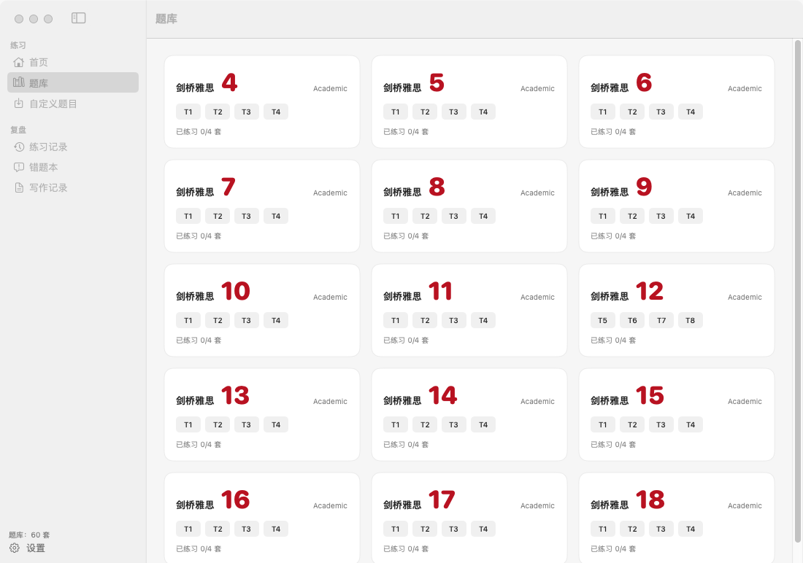 | 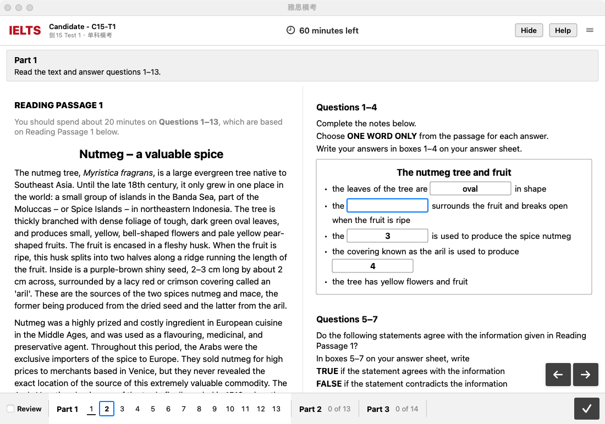 |

| 听力（录音连播） | 写作 |
|---|---|
| 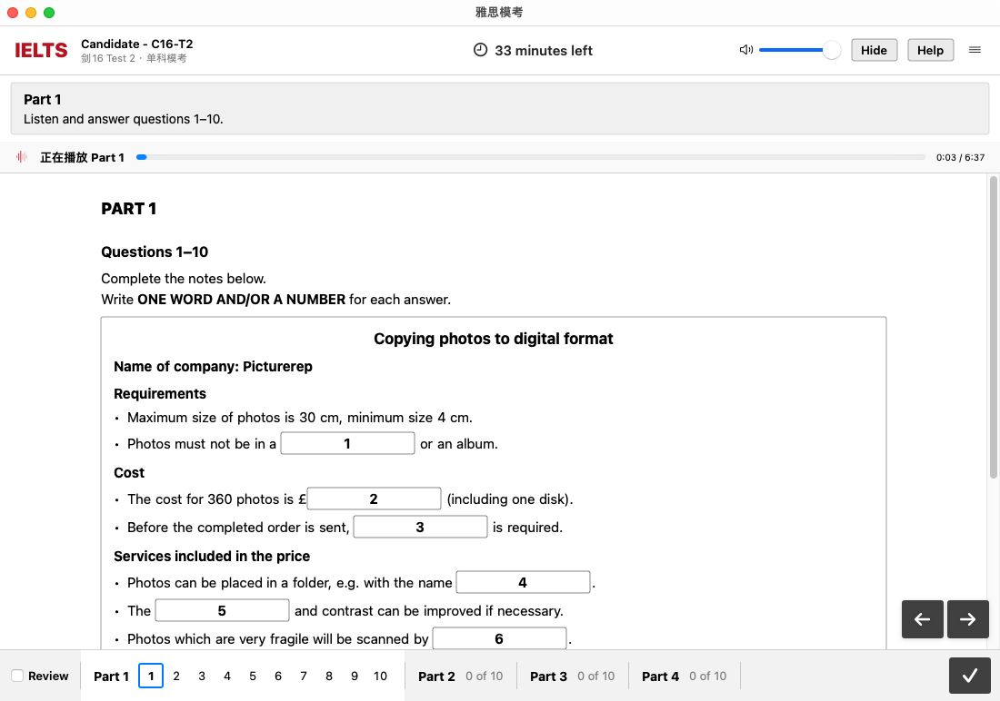 | 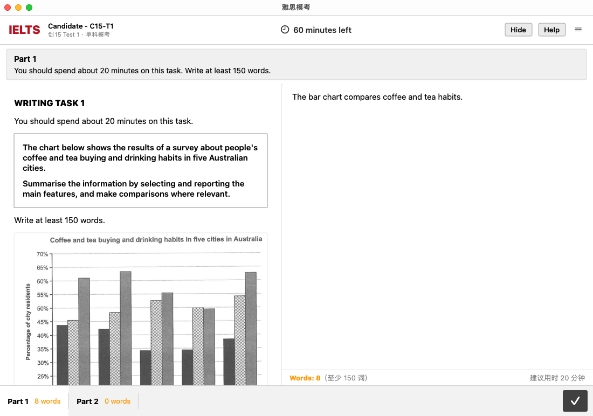 |

| 黑底黄字对比度 | 交卷结果 |
|---|---|
| 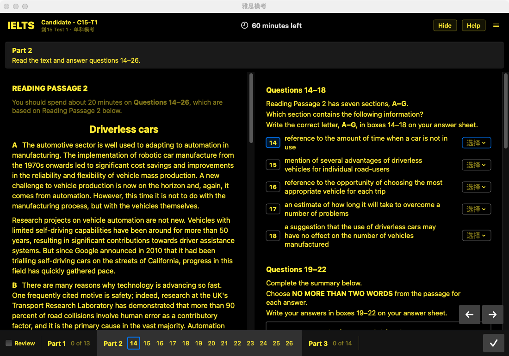 | 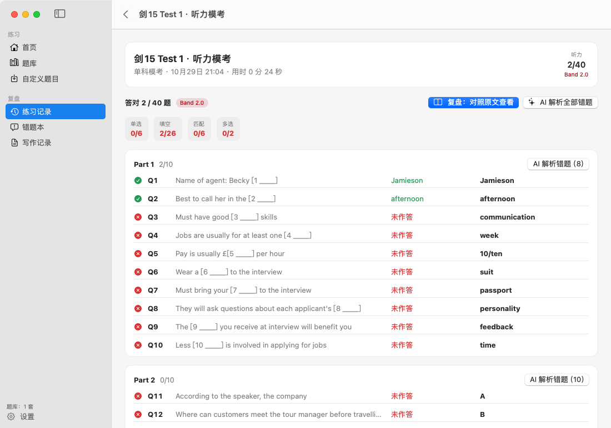 |

| 对照原文复盘 | 口语开考前检查 |
|---|---|
| 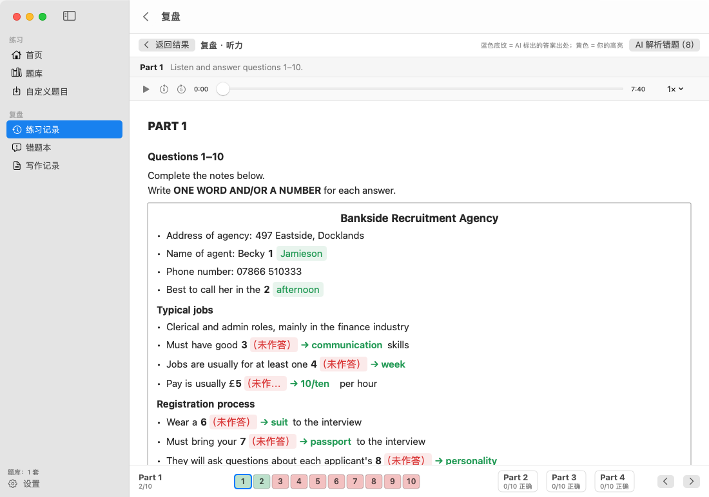 | 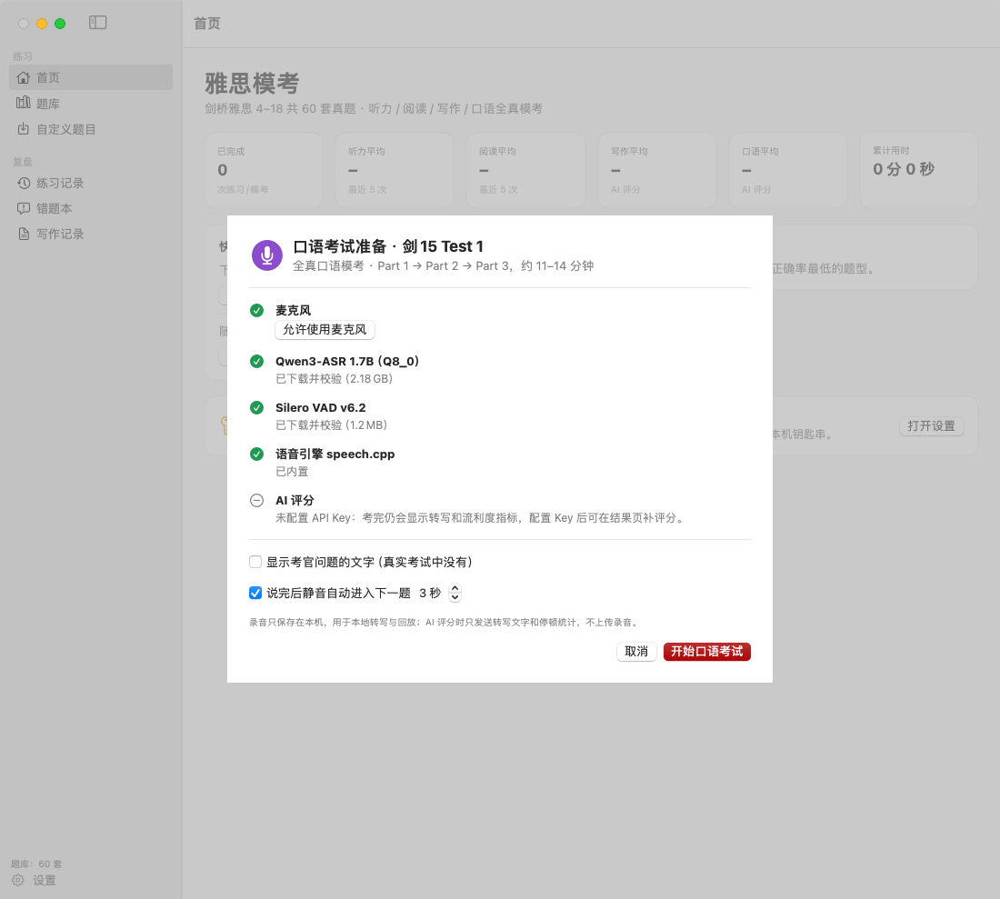 |

| 口语 Part 2：题卡与 1 分钟准备 | 口语 Part 2：独白计时 |
|---|---|
| 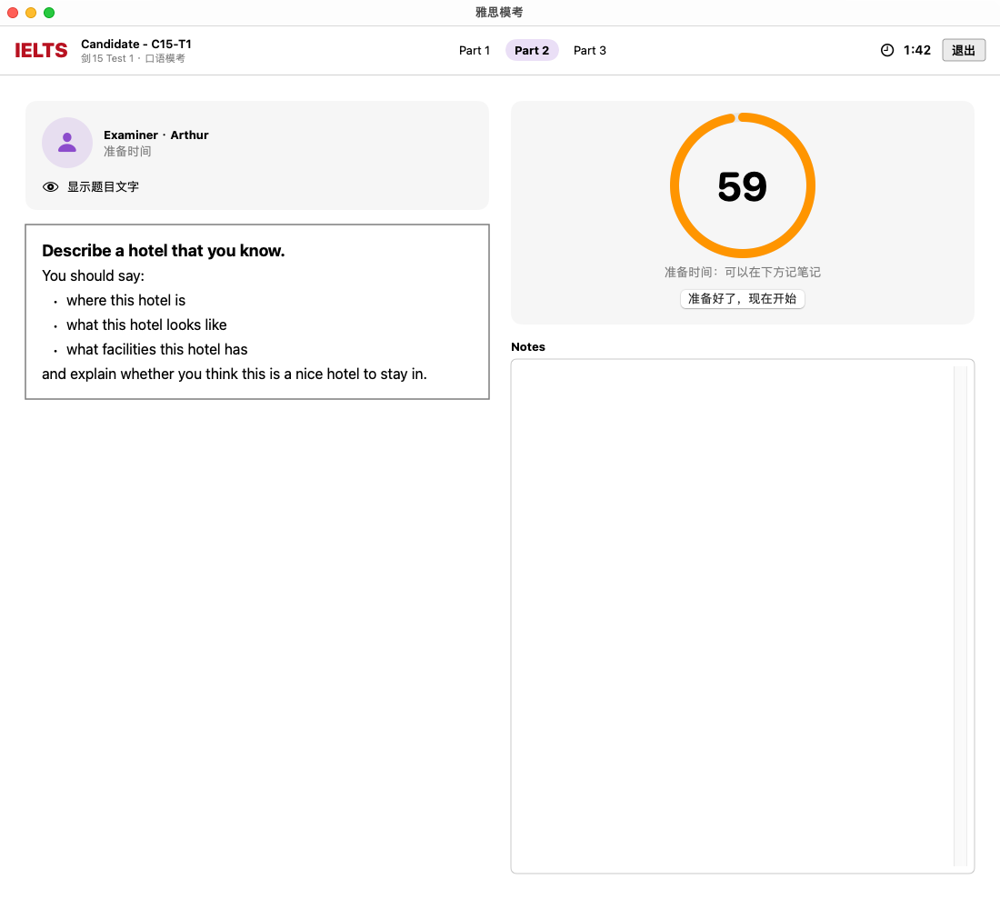 | 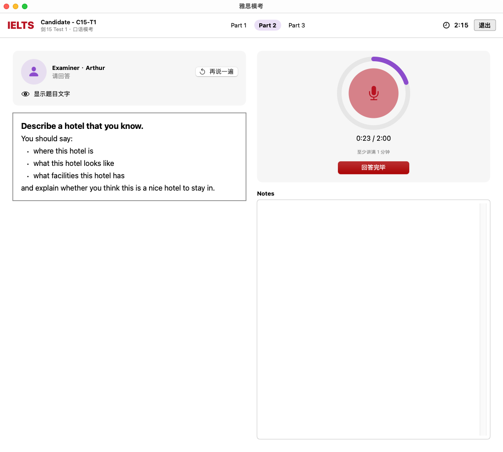 |

| 口语结果：流利度指标、逐题录音时间轴与转写 |
|---|
| 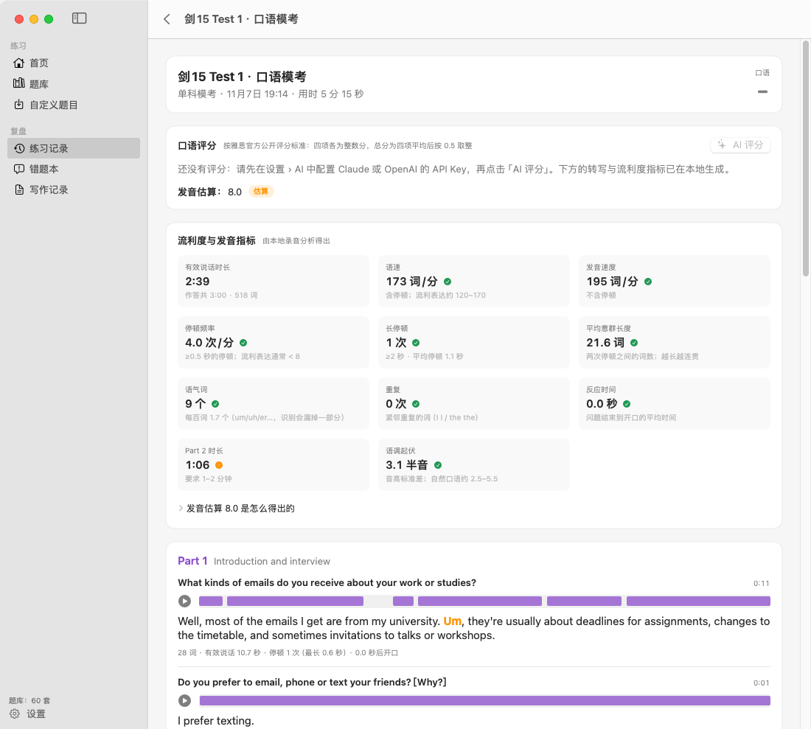 |

---

## 安装

1. 到 [Releases](../../releases/latest) 下载 `IELTSMock-x.y.z.dmg`（约 1.4 GB，题库和全部听力音频已内置）。
2. 双击打开 DMG，把「雅思模考」拖进「Applications（应用程序）」。
3. **第一次打开**：App 是本地自签名的，没有经过苹果公证，macOS 会提示"无法验证开发者"。
   - 在 Finder 中右键点 App →「打开」→ 再点「打开」；
   - 或者到「系统设置 › 隐私与安全性」，点「仍要打开」。
   
   之后就可以正常打开。

覆盖安装新版本不会丢失练习记录和 API Key。

**口语模块**第一次使用时需要下载本地语音识别模型（约 2.2 GB，来自 Hugging Face，下载后校验 SHA-256，之后完全离线）。网络不方便时可以勾选「国内镜像」（hf-mirror.com），或在设置 › 口语中「导入文件」。还需要允许 App 使用麦克风。

---

## 使用指南

### 开始一场考试
- 在**首页 › 快速开始**直接开始下一套没做过的题，或者随机练一篇阅读。
- 也可以在**题库**里选书和套题，进入详情页后选择：
  - **开始全真模考**：听力、阅读、写作连考；
  - **听力模考 / 阅读模考 / 写作模考**：单科；
  - 某个 Part / Passage / Task 后面的**练习**：专项练习。
- 每个科目开始前有一页考生须知，点**开始**后才计时。

### 作答
| 操作 | 方式 |
|---|---|
| 上一题 / 下一题 | 右下角 ← →，或 ⌘← / ⌘→ |
| 填空后跳到下一题 | 回车 |
| 标记稍后检查 | 底部左侧勾选 **Review** |
| 高亮文章 | 选中文字 → 右键 → 高亮 |
| 标题匹配 | 把标题拖到段落上方，或用下拉框选择 |
| 调字号 | ☰ › Text size，或 ⌘+ / ⌘- / ⌘0 |
| 调对比度 | ☰ › Contrast |
| 隐藏计时 | 顶栏 **Hide** |
| 交卷 | 右下角 ✓ |
| 退出（保存进度） | ☰ › 退出考试 |

### 口语考试
1. 在题目详情页点 **口语模考**（全真三个部分），或在 Part 1 / 2 / 3 后面点 **练习**。
2. 开考前的检查页会依次确认：麦克风权限和音量、识别模型、语音引擎、AI Key（没有 Key 也能考，只是先不出分）。
3. 考官提问后自动开始录音。说完点 **回答完毕**（⌘↩），或停顿几秒后自动进入下一题（秒数可在设置里改，也可以关闭）。
4. 听不清可以点 **再说一遍**；默认不显示题目文字（和真实考试一样），需要时点 **显示题目文字**。
5. Part 2：看题卡准备 1 分钟（可在下方记笔记，可提前开始），然后讲 1–2 分钟。
6. 考完自动完成转写、停顿与语调分析和 AI 评分，结果在练习记录里，可以逐题回放。

### 判分规则
- 不区分大小写，忽略首尾标点；£ $ € 这类题目里已经印出的单位可写可不写。
- 1,500 和 1500 视为相同，9:30 和 9.30 视为相同。
- 答案键里的可选词，比如 `(the) harbour / harbor`，会展开成所有可接受的写法。
- 标注 **IN EITHER ORDER** 的两题，答案顺序不限。
- 多选题按每个正确选项计分。
- 不检查字数限制，请自己注意题目要求，比如 "NO MORE THAN TWO WORDS"。
- 原始分按剑桥官方学术类换算表转成 Band 分。

---

## 口语模考与评分

```
考官语音提问 ─▶ 录音（16 kHz WAV，存在本机）─▶ speech.cpp worker（Qwen3-ASR 1.7B，考试中逐题转写）
                                              └▶ Silero VAD（说话段 / 停顿）+ 音高分析（语调起伏）
                                                         │
                       转写 + 停顿统计 + 官方评分描述 ─▶ Claude / OpenAI：FC、LR、GRA 三项整数分 + 逐题点评
                                                         │
                       本地估算发音分（与 FC 综合取整） ─▶ 四项平均，按官方规则取整到 0.5 = 口语总分
```

| 评分项 | 怎么得出 |
|---|---|
| 流利度与连贯（FC） | AI 按官方描述评分，同时参考本地测得的停顿、语速、意群长度、反应时间 |
| 词汇丰富度（LR） | AI 根据转写评分，给出原话依据 |
| 语法多样性与准确性（GRA） | AI 根据转写评分，给出原话依据与改错 |
| 发音（P）**估算** | 本地：可懂度（识别出的非正常单词比例）、语调起伏（音高标准差）、发音速度、停顿节奏，从 6.0 起增减，再与 FC 平均后取整。真实考试的发音由考官听音评定，这里只能粗略估计 |

需要知道的局限：
- 转写由机器识别，可能漏掉部分 "um / er"，也可能把个别小语法错误自动改正（如 he enjoy → he enjoys），所以语法分可能略偏高；明显的错误（如 "I have went"）会保留。
- 录音时请尽量在安静的环境，使用耳机麦克风效果最好。
- 发给 AI 的只有转写文字和停顿统计，录音本身不会上传。

## AI 解析与写作评分（BYOK）

1. 打开**设置 › AI**，选择服务商（Claude 或 OpenAI），粘贴 API Key，点**保存 Key**，再点**测试连接**。
2. 交卷后在结果页点 **AI 解析错题**，可以解析某个 Part / Passage，也可以一次解析全部；写作页点 **AI 评分**；口语考完会自动评分，也可以在结果页 **重新评分**。
3. 可以调整的选项：

| 设置 | 默认值 | 说明 |
|---|---|---|
| 模型（Claude） | `claude-opus-5-5` | 也可以选 Sonnet 5.5 / Haiku 5.5 / Fable 5.1，或者自己填写模型名 |
| 模型（OpenAI） | `gpt-6-astra` | 可选列表中的其他型号，或者自己填写 |
| Base URL | 官方地址 | 可以填 Anthropic / OpenAI 兼容的代理或中转地址 |
| 错题解析推理强度 / 写作与口语评分推理强度 | medium / high | 越高越细致，也越慢、越贵 |
| 解析语言 | 简体中文 | 也可以选 English |

- 请求使用流式输出和 JSON Schema 结构化结果；如果自定义端点不支持某个参数，会自动降级重试。
- Key 只存在本机**钥匙串**里，不会写进配置文件，也不会发到任何第三方服务。
- 费用由你的 API 账户承担。解析一个 Part 的错题大约需要一次请求，写作评分每篇一次请求，口语评分每场一次请求。

---

## 题库说明

| 书 | 套题 | 来源 | 备注 |
|---|---|---|---|
| 剑 4 | T1–T4 | 原书完整扫描 | |
| 剑 5–8 | T1–T4 | 原书扫描 | 剑 5 只取学术类；部分配图上印有第三方水印，已经去除 |
| 剑 9 | T1–T4 | 第三方重新排版的电子版 | 明显的录入错误已改正，每处改动都记在该套题的 `issues` 里 |
| 剑 10–11 | T1–T4 | 原书扫描 | |
| 剑 12 | T5–T8 | 原书扫描 | 剑 12 的套题编号就是 5–8 |
| 剑 13–18 | T1–T4 | 原书扫描 | |

口语题来自每套题的 Speaking 页（Part 1 话题与问题、Part 2 题卡、Part 3 讨论题），原书印的 `[Why?]` 等追问提示都保留了；原书没有印口语范文。

**已知缺口**
- **剑 15 Test 4**：听力 Part 1、Part 2 的录音缺失，源仓库中没有这两段音频。可以在该套题的详情页用「导入音频…」补上。
- **剑 13 Test 3**：扫描件缺原书第 54–55 页，听力第 1–16 题的题面依据三份网上录入版重建，并和原书答案、听力原文交叉核对过。
- 少数地方原书本身就有印刷错误，比如题目说明写"七段"，实际有八段；这些都按原书照录，并在 `issues` 里注明。

每套题的 `issues` 字段记录了所有不能完全照原书还原的地方，以及每一处人工判断。

---

## 从源码构建

需要 macOS 14+ 和 Xcode 命令行工具（Swift 5.10+）。

```bash
git clone https://github.com/yanboishere/ielts-mock.git
cd ielts-mock/app

swift build                 # 编译
scripts/build_speech.sh     # 编译口语用的 speech.cpp 引擎（需要 cmake），输出到 Vendor/speech/
scripts/build_app.sh        # 生成 build/雅思模考.app（自签名，会把 speech 引擎一起打包）
scripts/build_app.sh --install   # 生成并拷贝到 /Applications
```

### 安装题库

仓库里有全部题目的 JSON 和配图（`data/bank/`），但**没有听力音频和原书页面图**，它们体积太大，只打包在 Release 的 DMG 里。你可以：

- **最简单**：从 Release DMG 里的 `雅思模考.app/Contents/Resources/Bank` 拷出完整题库；
- **自己生成**：准备好原书 PDF 和音频，按下一节的流程跑一遍，然后用
  ```bash
  scripts/install_bank.py            # 安装到 ~/Library/Application Support/IELTSMock/Bank
  ```
  `install_bank.py` 会按 `data/build/audiomap.json` 把音频复制进题库，并生成「原书页面」用的缩略图。

App 查找题库的顺序：设置里指定的文件夹 → App 包内的 `Contents/Resources/Bank` → `~/Library/Application Support/IELTSMock/Bank`。

### 打包 DMG

```bash
scripts/make_dmg.sh   # 把题库打进 App，生成 build/雅思模考-<版本>.dmg
```

### 开发调试
- `IELTSMOCK_DEBUG=1` 启动时会开启一个本地调试通道。用 `scripts/debugctl.swift` 可以远程操作 App，例如切换页面、开考、填写答案、交卷，还能截取窗口图，不需要屏幕录制权限。
- `scripts/mock_llm.py` 是一个本地假的 Claude / OpenAI 端点。它按请求里的 JSON Schema 生成结果，可以在不花钱的情况下测试 AI 相关流程。
- 口语可以不用麦克风测试：调试通道的 `spkfeed a.wav,b.wav` 让每道题依次"回答"指定的录音，`spkmute 1` 让考官静音，`speaking C15-T1` 直接开考。

---

## 题库是怎么做出来的

```
原书 PDF ──渲染+OCR──▶ 逐页文字和坐标 ──结构识别──▶ 页码索引
                                         │
                       抽题（每套一个 AI 代理，看页面图 + OCR）
                                         ▼
             data/work/BOOK-TN/{listening,reading,writing,speaking}.json
                                         │  ielts assemble（合并 + 校验）
                                         ▼
                        data/bank/exams/BOOK-TN.json ──▶ App
```

1. **渲染与 OCR**（`tools/pdfrender.swift`、`tools/pdfocr.swift`）：用 macOS 自带的 PDFKit 和 Vision 把每一页渲染成图片，识别出文字，并保留每一行的坐标。
2. **结构识别**（`tools/py/events.py`、`structure.py`）：找出每套题的听力、阅读、写作页码，以及听力原文、答案页、范文页的位置。音频按书 / 套题 / Part 对应到文件（`audiomap.py`）。
3. **抽题**：每套题交给一个 AI 代理，按 `data/AGENT_BRIEF.md` 和 `data/SCHEMA.md` 工作：
   - 用 `tools/bin/ielts` 查看页面、局部放大重新 OCR、裁剪配图；
   - 照原书逐字录入题目和文章；
   - 答案一律**看答案页图片**逐栏转录。
   - 口语题按 `data/SPEAKING_BRIEF.md` 单独抽取，每本书一个代理。
4. **合并与校验**（`ielts assemble` / `ielts validate`）：检查题号 1–40 是否各出现一次、每个空是否都有答案、选项字母是否对得上、图片是否存在等。
5. **质检**（`tools/qa/`）：
   - `coverage.py`：把原书页面切成重叠的横条，放大后**重新做一次 OCR**，逐行确认每一句都在题库 JSON 里，用来找出漏行；
   - `confirm_flags.py`：对标出的行做模糊匹配，排除重新识别时认错字造成的误报，剩下的再人工看原图确认；
   - `dewatermark.swift`：去掉黑白配图上的彩色第三方水印。

`data/qa/` 里是每本书的质检报告，`data/work/` 里是每套题的分模块工作文件。

---

## 仓库结构

```
app/                     macOS App（SwiftUI，Swift Package）
  Sources/IELTSMock/
    App/                 入口、全局状态、调试通道
    Model/               题目数据模型、判分与 Band 换算、练习记录
    Bank/ Store/         题库加载、设置、钥匙串、历史记录
    Exam/                考试会话（计时、提醒、听力连播、自动保存）
    Speech/              口语：模型下载与校验、speech.cpp worker、录音、考官语音、考试流程、停顿与语调分析
    AI/                  Claude / OpenAI 客户端、提示词、结构化输出
    Views/               首页 / 题库 / 考试 / 口语 / 复盘 / 错题本 / 写作记录 / 设置
  scripts/               build_app.sh · build_speech.sh · make_dmg.sh · install_bank.py · debugctl · mock_llm.py
tools/                   抽题和质检工具（Swift + Python）
  bin/ielts              抽题命令行工具：pagetext / pageview / ocrzoom / figcrop / assemble / validate …
  qa/                    coverage / confirm_flags / dewatermark
  build.sh               编译 Swift 工具
data/
  SCHEMA.md              题库 JSON 格式说明
  AGENT_BRIEF.md         抽题规范（给代理的工作说明）
  SPEAKING_BRIEF.md      口语题抽取规范
  books.json             每本书的来源 PDF 和套题编号
  bank/exams/            60 套题的 JSON
  bank/images/           题目用到的地图、图表和写作 Task 1 图
  work/                  每套题的分模块工作文件
  build/audiomap.json    听力音频对应表
  qa/                    逐行完整性检查报告
docs/screenshots/        README 截图
```

抽题工具默认在 `~/ielts-tools` 和 `~/ielts-data` 下工作，用软链接即可：

```bash
ln -s "$PWD/tools" ~/ielts-tools && ln -s "$PWD/data" ~/ielts-data && tools/build.sh
```

---

## 隐私

- 所有练习记录、作文和设置都只保存在本机：`~/Library/Application Support/IELTSMock` 和钥匙串。
- 口语录音保存在 `~/Library/Application Support/IELTSMock/Recordings`，只用于本地转写和回放；删除练习记录时一起删除。
- App 只在你主动使用 AI 功能时联网，直接请求你配置的 Claude / OpenAI 端点。请求内容包括相关文章或听力原文、题目、你的答案、作文，或口语的转写文字与停顿统计（不含录音）。
- 下载语音识别模型时会访问 huggingface.co（或你选择的 hf-mirror.com）。
- 没有任何统计、遥测或第三方服务。

---

## 第三方组件

| 组件 | 用途 | 许可证 |
|---|---|---|
| [Qwen3-ASR 1.7B](https://huggingface.co/Qwen/Qwen3-ASR-1.7B)（[GGUF Q8_0](https://huggingface.co/sakasegawa/Qwen3-ASR-1.7B-GGUF)） | 口语语音识别 | Apache-2.0 |
| [speech.cpp](https://github.com/nyosegawa/speech.cpp) 0.8.11 + ggml | 本地推理引擎（Metal 加速） | MIT |
| [Silero VAD](https://github.com/snakers4/silero-vad) v6.2（[GGUF](https://huggingface.co/sakasegawa/silero-vad-GGUF)） | 说话段与停顿检测 | MIT |

口语的识别方案参照了 [AstraFoundry/Arion](https://github.com/AstraFoundry/Arion)：使用与 Arion 相同的模型（Qwen3-ASR 1.7B Q8_0）和推理引擎（speech.cpp），版本与 SHA-256 也按 Arion 的锁定值。本项目没有包含 Arion（AGPL-3.0）的代码。speech.cpp 与 ggml 的许可证随 App 一起分发（`Contents/Resources/speech/`）。

## 版权声明

本项目的**源代码和工具**由作者编写。

**题库内容**（题目、文章、听力原文、录音、范文和图表）来自《剑桥雅思真题》（Cambridge IELTS）系列，版权归 **Cambridge University Press & Assessment** 所有。本仓库整理这些内容**仅供个人学习和交流使用，请勿用于任何商业用途**。如果你是版权方并希望移除相关内容，请提交 Issue 联系，收到后会尽快处理。请支持正版图书。

IELTS 是 British Council、IDP: IELTS Australia 和 Cambridge University Press & Assessment 的注册商标，本项目与上述机构没有任何关联。
